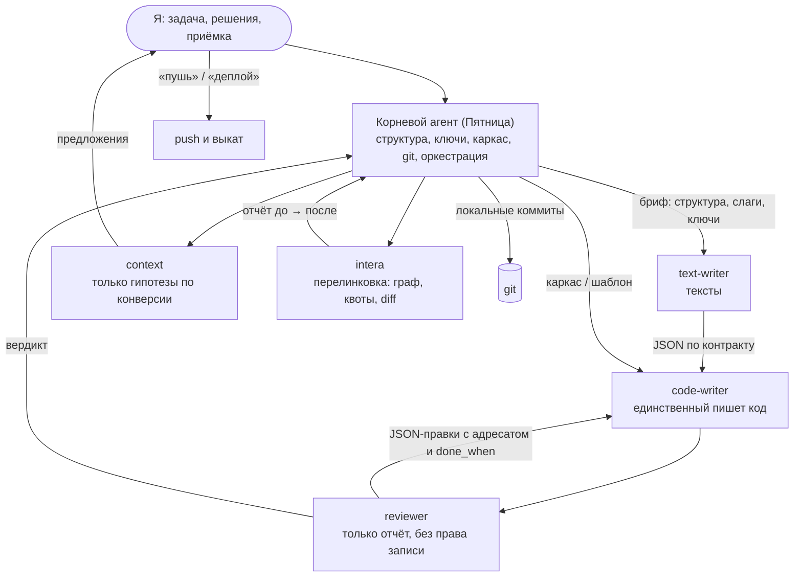

# Команда ИИ-агентов для производства сайтов

Система из корневого агента и пяти субагентов на Claude Code. Она собирает и поддерживает парк
статических сайтов-обзорников: структура → тексты → код → ревью → конверсия → перелинковка.

Систему спроектировал я: состав и роли, границы ответственности, права каждого агента, контракты между
ними, правила качества, ограничения на необратимые действия, память и отчёты. Код сайтов пишут агенты.
Что именно моё — по пунктам и с датами — в [`CONTRIBUTION.md`](CONTRIBUTION.md).

> Конфиги здесь рабочие, но очищенные: убраны названия клиентов, домены, серверы, имена коллег и
> правила, специфичные для конкретных ниш.

## Кто что делает

| Зона | Я | Агенты |
|---|---|---|
| Архитектура: состав, роли, границы, права | проектирую и меняю | работают в заданных рамках |
| Правила вёрстки, SEO, мобилки, перелинковки | формулирую, утверждаю, разрешаю конфликты | применяют; `reviewer` проверяет |
| Код страниц | правлю промпты агентов, код руками не пишу | `code-writer` — единственный, кто пишет код страниц; корневой агент — каркасы |
| Тексты | бриф и выбор режима | `text-writer` |
| Приёмка | решаю, что идёт в прод | `reviewer` — отчёт и машинный блок правок |
| `git push`, деплой | только по моей команде | запрещены без неё: правилами и классификатором |
| Партнёрские ссылки | проверяю сам | агентам нельзя даже открывать |
| Память и отчёты | задаю структуру и формат | ведут волт, пишут отчёты по хуку |

## Как устроено



### Принципы

1. **Один писатель кода.** Код страниц пишет только `code-writer`. Остальные отдают ему тексты, отчёты
   и предложения — двух правок одного места не бывает.
2. **Права через список инструментов.** У `reviewer` и `context` нет Write/Edit: они физически не могут
   ничего изменить, только сказать.
3. **Контракты между агентами.** `text-writer` отдаёт JSON фиксированной схемы, `reviewer` — машинный
   блок правок с адресатом и критерием `done_when`, `context` — гипотезы с метрикой проверки.
4. **Проверка по артефакту, а не по отчёту.** «Ложный зелёный хуже честного провала»: каждый агент
   обязан назвать, где недотянул и что не проверил глазами.
5. **Два замка на необратимое.** Пуш и деплой запрещены правилами и отдельно — классификатором auto
   mode; живые партнёрские редиректы — жёсткий запрет, который не снимается ничем.
6. **Память вне модели.** Единственная память — Obsidian-волт, общий для Claude Code и Codex: один файл
   на проект с шестью секциями, решения с датой и источником. Встроенная автопамять выключена.
7. **Отчёты без дублей.** Хук `UserPromptSubmit` отдаёт отчёт ровно одной сессии из всех открытых окон —
   захват атомарным `mkdir`.
8. **Решения владельца сильнее общих норм.** Расхождение агент не решает сам — выносит вопрос, решение
   записывается в карточку проекта.

## Что в репозитории

| Путь | Что это |
|---|---|
| [`CONTRIBUTION.md`](CONTRIBUTION.md) | Мои решения с датами и разделение «я / агенты» |
| [`agents/`](agents/) | Определения пяти субагентов: `code-writer`, `text-writer`, `reviewer`, `context`, `intera` |
| [`intera/`](intera/) | Нормы перелинковки и скрипт графа ссылок `linkgraph.py` (Python stdlib, ~950 строк) |
| [`guardrails/auto-mode.md`](guardrails/auto-mode.md) | Запреты для классификатора auto mode |
| [`memory/project-card.md`](memory/project-card.md) | Шаблон карточки проекта в волте |

## Стек

Claude Code (Opus 5.5 у всех агентов: корневой на `effort max`, субагенты на `xhigh`), Codex как второй
исполнитель с общей памятью, Obsidian, bash-хуки, Python. Работает на VPS; доступ к ноутбуку — через
обратный SSH-туннель и Tailscale.

## Масштаб

На 20.11.2026: в 45 из 56 рабочих репозиториев есть коммиты агентов — 910 коммитов с трейлером
`Co-Authored-By: Claude` из 2693. Это нижняя граница: в части репозиториев трейлер намеренно не ставился.

## Проверка

```sh
# скрипт перелинковки на любом собранном статическом сайте
python3 intera/linkgraph.py init ./site --domain example.org > targets.json
python3 intera/linkgraph.py scan ./site --config targets.json --out ./before
```
